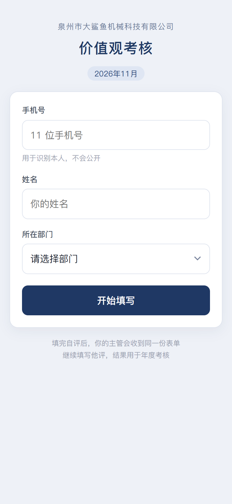
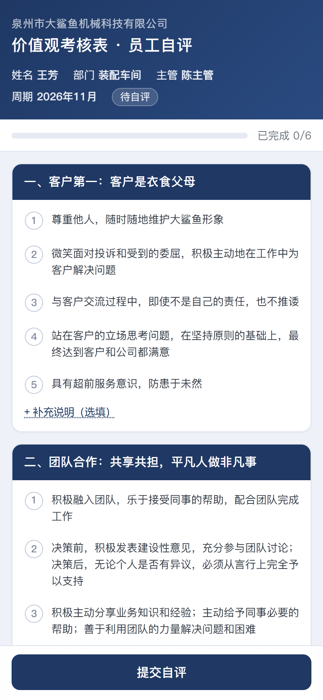
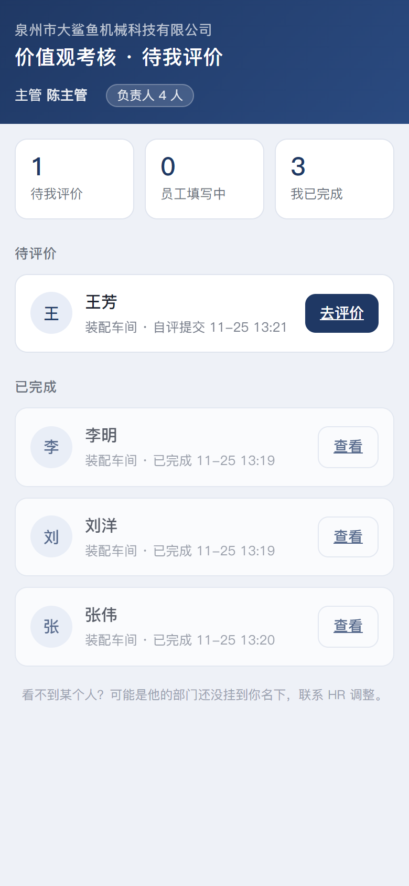
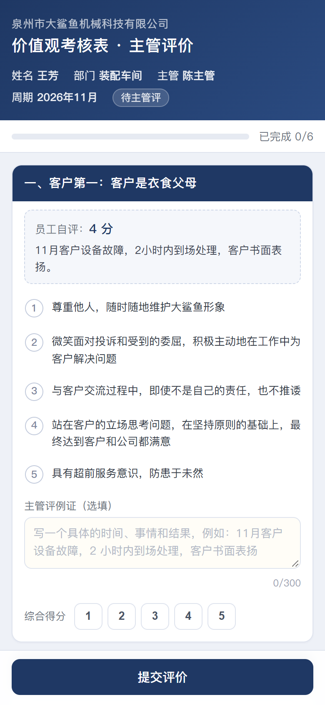
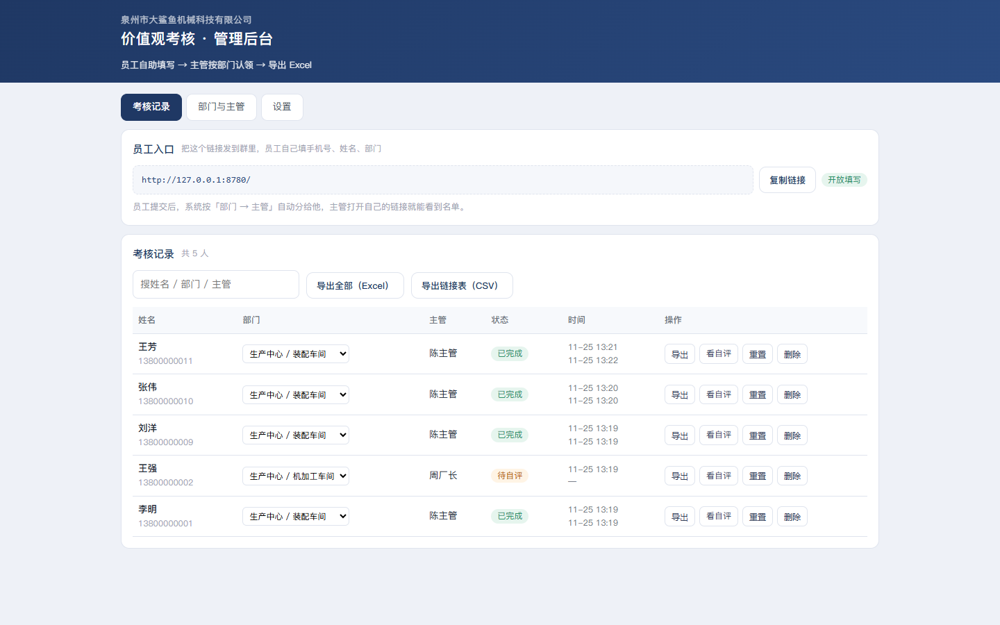
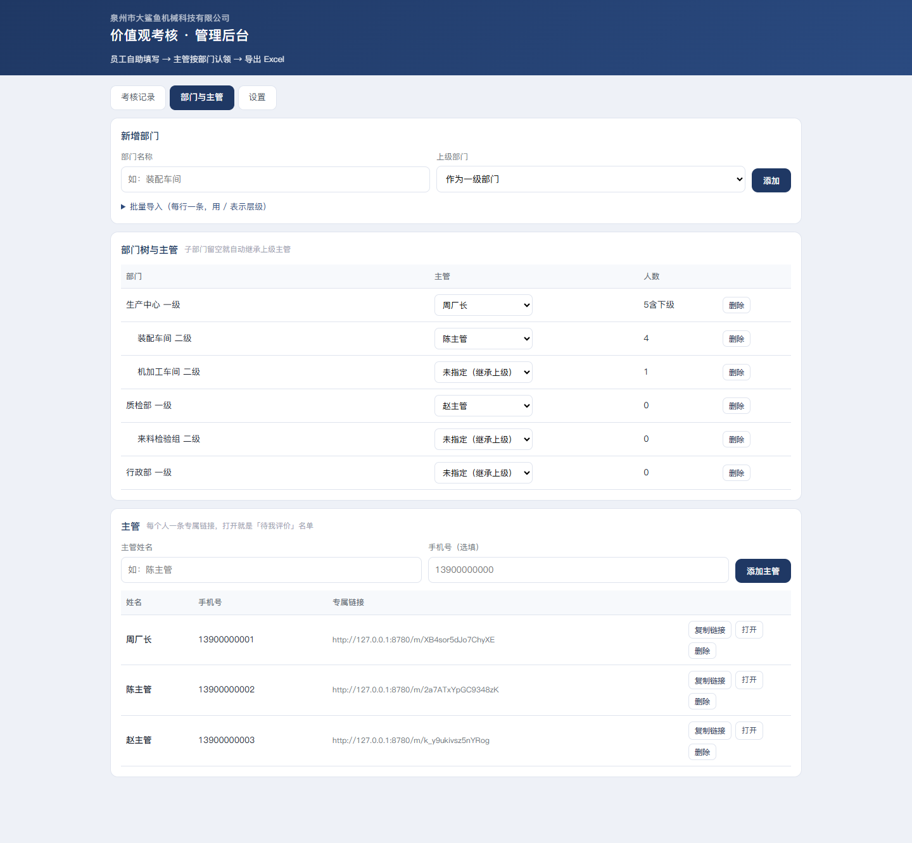

# 价值观考核在线填报（Values Review）

把一年一度的纸质《价值观考核表》搬到线上：**员工自己进来填自评 → 系统按部门自动找到他的主管 → 主管在自己的名单里逐个评价 → HR 一键导出和纸质表同版的 Excel。**

不依赖任何第三方 SaaS，数据存本地 SQLite，可完全内网运行。



## 为什么做这个

原来的流程是打印 A4 表 → 发 → 催 → 收 → 手抄进 Excel。四个堵点：发放回收靠人、分派靠记忆、汇总靠手抄、版式写字挤。

现在：

- **员工自助**：把入口链接发群里，员工填手机号 + 姓名 + 选部门就能开始，不用 HR 逐个建单
- **自动分派**：部门树上挂主管，员工提交后自动落到"最近一级主管"，子部门没设主管就继承上级
- **主管有队列**：每位主管一条专属链接，打开就是「待我评价」，点名字直接填，能看到员工自评
- **导出即打印**：导出的一页 A4 和纸质版一致；批量导出还带一张汇总表

## 界面

| 员工自评 | 主管队列 | 主管评价 |
|---|---|---|
|  |  |  |

| 后台 · 考核记录 | 后台 · 部门与主管 |
|---|---|
|  |  |

## 快速开始

需要 Python 3.10+。

```bash
pip install -r requirements.txt
python app.py
```

打开：

- 员工入口 <http://127.0.0.1:8780/>
- 管理后台 <http://127.0.0.1:8780/admin>，默认密码 `admin123`

> 首次启动会种一套示例组织（生产中心 / 装配车间 / 机加工车间、质检部 / 来料检验组、行政部）和三个示例主管，方便直接点。
> 清空数据：停服务 → 删 `data/review.db` → 重启。

### 环境变量

| 变量 | 默认 | 说明 |
|---|---|---|
| `REVIEW_PORT` | `8780` | 端口 |
| `REVIEW_ADMIN_PASSWORD` | `admin123` | 后台密码，上线前必改 |
| `REVIEW_SECRET` | 内置字符串 | Cookie 签名密钥，上线前必改 |
| `REVIEW_DB` | `data/review.db` | 数据库路径 |

## 使用流程

1. 后台 →「部门与主管」：建部门树、给部门挂主管、添加主管（每人一条链接）
2. 后台 →「考核记录」：复制**员工入口链接**发出去
3. 员工填完自评 → 记录变「待主管评」
4. 把主管链接发给主管（或主管自己收藏）→ 打开就是待评价名单
5. 主管提交 →「已完成」→ HR 导出

## 目录

```
.
├─ app.py                 # FastAPI：登记、部门/主管、表单、队列、导出
├─ content.py             # 考核内容（6 价值观 × 5 级），改标准只改这里
├─ export_xlsx.py         # 导出与纸质表同版的 Excel
├─ static/
│  ├─ join.html           # 员工入口
│  ├─ form.html           # 自评 / 他评
│  ├─ manager.html        # 主管队列
│  ├─ admin.html          # HR 后台
│  └─ app.css
├─ docs/
│  ├─ PRD.md              # 产品需求文档（功能清单、数据模型、路线图）
│  └─ images/
├─ tests/
│  ├─ smoke_api.py        # 接口冒烟测试（无需额外依赖）
│  └─ smoke_ui.py         # 浏览器走查（可选，需 playwright）
└─ 启动.bat
```

## 测试

```bash
python tests/smoke_api.py
```

会用一个临时数据库在 8799 端口起服务，跑完整流程（登记 → 自评 → 主管队列 → 评价 → 导出 → 校验），结束后自动清理，不动你的正式数据。

浏览器走查（可选，需要 `pip install playwright && playwright install chromium`）：

```bash
python tests/smoke_ui.py
```

## 业务规则

- **通关制**：勾选所达到的最高级别；前面小分值未达到时，后面的分数不计
- **4–5 分必须写例证**（≥ 8 字），前端提示 + 服务端校验双保险
- **提交即锁定**：员工提交后自评不可改，主管提交后本份不可改；要改只能 HR 重置
- **手机号是身份**：同一手机号同一周期只有一份档案，换姓名会被拒绝

## 安全与隐私

- 员工/主管链接是随机 token，猜不到；没有账号密码
- 后台密码 + 签名 Cookie
- 手机号与评价属个人信息：**内网部署**，上公网请套 HTTPS 反向代理
- 员工入口是公开的，理论上可代填；需要更严可加统一口令或对接企业微信（见 PRD 路线图）

## 产品文档

详细功能清单、数据模型、接口清单、验收标准与路线图：[docs/PRD.md](docs/PRD.md)

## License

MIT
